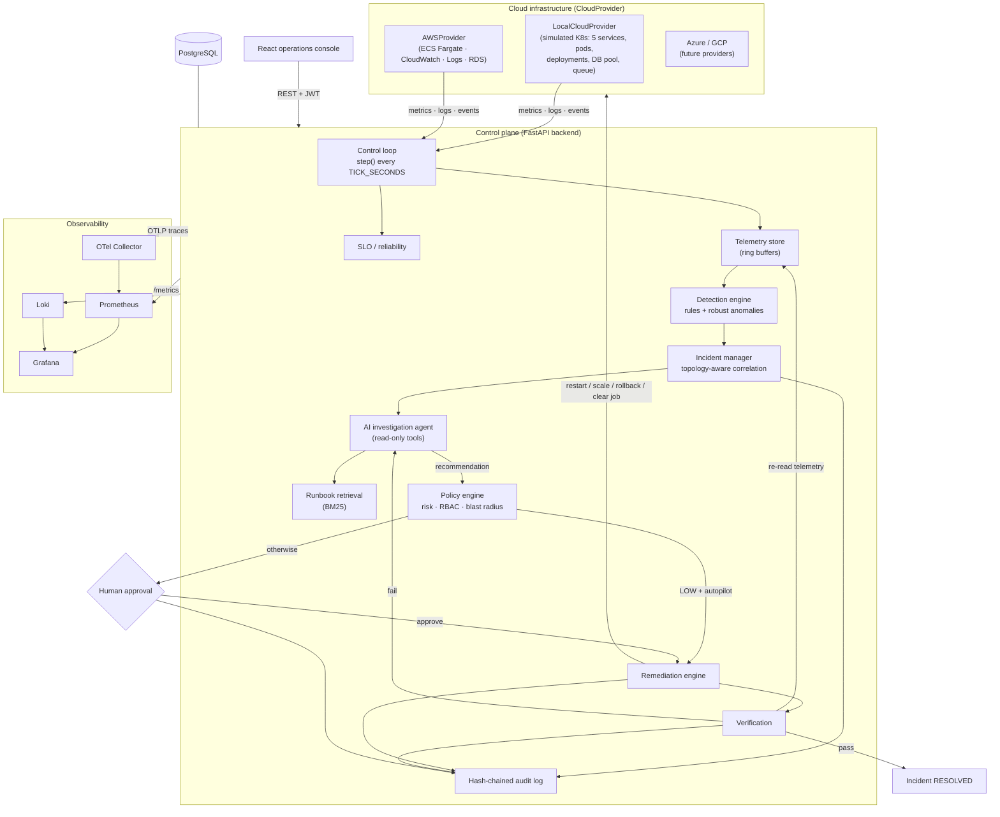
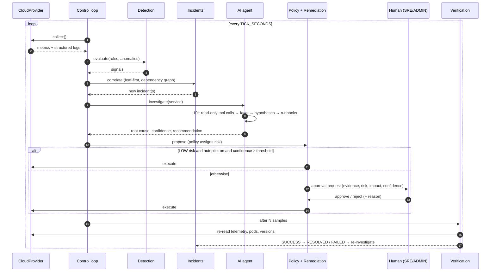
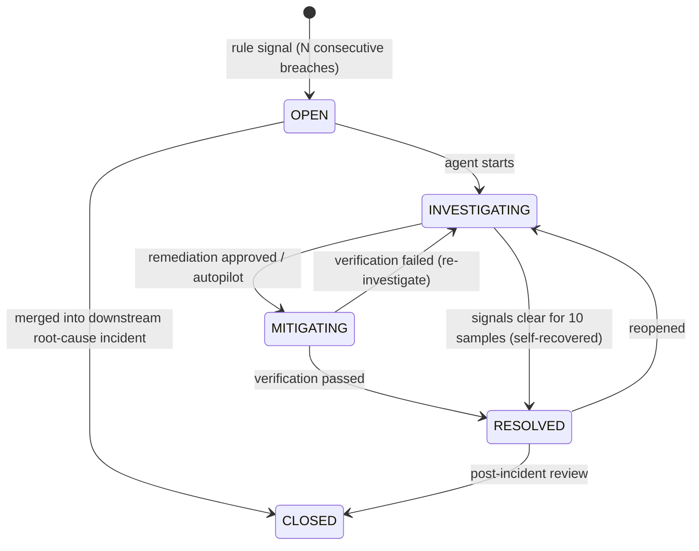
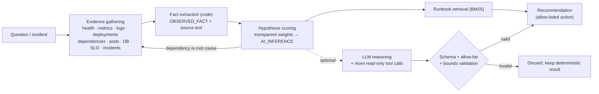
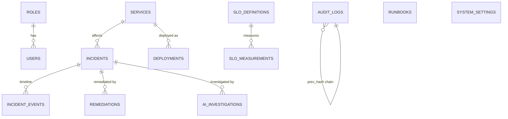

# CloudOps AI — Architecture

## System overview

## Repository layout

| Path | Purpose |
|---|---|
| `backend/app/control_plane.py` | Orchestrates the loop: detect → correlate → investigate → propose → execute → verify → resolve |
| `backend/app/cloud/` | `CloudProvider` interface, `LocalCloudProvider` + simulation, `AWSProvider` |
| `backend/app/detection/` | Threshold rules with `for`-durations, MAD anomaly detection, health model |
| `backend/app/remediation/policy.py` | Allowed actions, parameter validation, risk assessment |
| `backend/app/slo/` | SLO definitions, error budgets, burn rates, MTTD/MTTR |
| `backend/app/runbooks/` | Runbook parsing and BM25 retrieval |
| `backend/app/core/` | Config, clock, JWT/RBAC, hash-chained audit, rate limiting, JSON logging |
| `backend/app/api/` | REST API (OpenAPI at `/api/docs`) |
| `ai-agent/cloudops_agent/` | Agent: tool registry, analyzer (facts + hypotheses), investigator, LLM provider |
| `frontend/` | React + TypeScript + Tailwind console (13 pages) |
| `services/` | Real demo microservice (one image, four roles) with chaos endpoints + load generator |
| `runbooks/` | Markdown runbooks with YAML front matter (loaded into the DB) |
| `observability/` | Prometheus (+ alert rules), Grafana provisioning, Loki, Promtail, OTel collector |
| `infrastructure/kubernetes/` | Kustomize base + local/aws overlays |
| `infrastructure/terraform/aws/` | VPC, ECS Fargate, RDS, ALB, ECR, IAM, S3, CloudWatch, Secrets Manager, Budgets |
| `automation/` | Game-day runner |
| `tests/` | unit · integration · e2e |

## The control loop

## Incident lifecycle

`remediation_status` tracks the action independently: `NONE → PENDING_APPROVAL → EXECUTING → VERIFYING → SUCCEEDED | FAILED | REJECTED | SUPERSEDED`.

## AI investigation design

Hypotheses covered: faulty deployment, DB connection leak, single-pod memory leak, crash loop,
runaway CPU, traffic saturation, outage, thread-pool starvation, dependency degradation (walks the
graph to the dependency and investigates it), queue backlog with a poison job.

## Data model

## Deployment topologies

| Mode | How | Provider |
|---|---|---|
| Developer | `make dev-backend` + `make dev-frontend`, local PostgreSQL | local (simulated) |
| Docker Compose | `make up` (platform + Prometheus/Grafana/Loki/OTel); `make up-all` adds real demo services + load | local (simulated) + real demo services observed by Prometheus |
| Kubernetes | `kubectl apply -k infrastructure/kubernetes/overlays/local` | local |
| AWS | `terraform apply` in `infrastructure/terraform/aws` | aws (ECS/CloudWatch/RDS) |

See [docs/architecture/DECISIONS.md](docs/architecture/DECISIONS.md) for the reasoning behind each choice.
