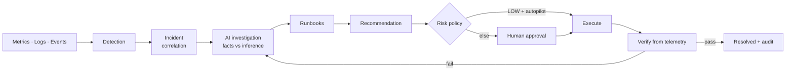

# CloudOps AI

**AI-powered cloud reliability, observability and self-healing operations platform.**

CloudOps AI answers one question for an on-call engineer:

> *What is wrong with my infrastructure, why is it happening, what should I do — and can the system safely fix it?*

It collects metrics and logs, detects incidents (threshold rules + robust anomaly detection),
correlates symptoms along the service dependency graph, investigates with a **tool-using AI agent**
that separates *observed facts* from *AI inference*, retrieves runbooks, recommends an allow-listed
remediation, gates it behind **risk policy + RBAC + human approval** (or autopilot for LOW risk),
executes it, and only resolves the incident after **verifying recovery from fresh telemetry**.
Everything is recorded in a **hash-chained audit log**.



## Highlights

| Area | What's implemented |
|---|---|
| **Local-first cloud** | `LocalCloudProvider`: a simulated Kubernetes-style platform (api-gateway, user/payment/notification services, PostgreSQL pool, job queue). Metrics are *computed from state*, so remediation genuinely changes them. All simulated data is labelled. |
| **AWS** | `AWSProvider` (ECS Fargate, CloudWatch, CloudWatch Logs, RDS) + Terraform (VPC, ECS, RDS, ALB, ECR, IAM least-privilege, S3, Secrets Manager, alarms, budget). |
| **Detection** | 9 rule types with `for`-durations (CPU, memory, errors, latency, crash loops, DB saturation, unavailability, queue backlog, SLO fast-burn) + median/MAD anomaly detection. |
| **Incidents** | Topology-aware correlation (one incident per root cause), severity escalation, 8-stage visual timeline, MTTD/MTTR. |
| **AI agent** | 11 read-only allow-listed tools, no shell. Deterministic evidence → facts (code) → hypotheses → runbooks. Optional OpenAI-compatible LLM with schema/allow-list validation; works fully without an API key. |
| **Remediation** | `restart_pod`, `restart_service`, `scale_deployment`, `rollback_deployment`, `clear_failed_job`. Policy-assigned risk, blast-radius guard, approval workflow, autopilot for LOW risk, verification with before/after state. |
| **SRE** | SLOs (request- and window-based SLIs), error budgets, 5m/1h burn rates, availability, MTTD, MTTR, incident frequency. |
| **Security** | JWT + bcrypt, server-side RBAC (ADMIN/SRE/DEVELOPER/VIEWER), DB-sourced permissions, strict input validation, rate limiting, CORS allow-list, security headers, hash-chained audit, non-root read-only containers, default-deny NetworkPolicies. |
| **Observability** | Prometheus (+ alert rules), Grafana dashboard, Loki + Promtail, OpenTelemetry tracing, structured JSON logs. |
| **Delivery** | Docker, Docker Compose, Kubernetes (Kustomize, HPA, PDB, probes, limits), GitHub Actions (lint → tests → security → image build → container scan → Terraform validate → deploy → smoke). |
| **Tests** | 118 Python tests (unit, API, RBAC, AI-tool safety, AWS via moto, end-to-end recovery for all 9 failure modes) on SQLite **and** PostgreSQL + frontend unit tests. |

## Quick start (local, no cloud account needed)

Prerequisites: Python 3.12 + [uv](https://docs.astral.sh/uv/), Node 20+, PostgreSQL 16 (or Docker).

```bash
make bootstrap      # installs deps, writes .env with random secrets + demo passwords (gitignored)
```

```bash
createdb cloudops_ai && make migrate
```

```bash
make dev-backend    # API + control loop on :8000 (OpenAPI at /api/docs)
```

```bash
make dev-frontend   # UI on :5173
```

Demo credentials are in `demo-credentials.txt` (generated, gitignored). Then follow [DEMO.md](DEMO.md).

### Full stack with Docker Compose

```bash
make up         # platform + Prometheus + Grafana + Loki + OTel collector
```

```bash
make up-all     # also runs the real demo microservices + load generator
```

UI `:3000` · API `:8000` · Grafana `:3001` · Prometheus `:9090` · Loki `:3100` (all bound to 127.0.0.1; ports overridable via `*_HOST_PORT` env vars).

### Kubernetes (local kind cluster)

```bash
make k8s-local   # builds images, creates the kind cluster, Secrets from .env, applies, smoke-tests
```

```bash
make k8s-down
```

### Tests

```bash
make test            # 118 Python tests (SQLite) + frontend tests
```

```bash
make test-postgres   # same suite on PostgreSQL
```

```bash
make e2e             # end-to-end incident recovery scenarios only
```

## Using an LLM (optional)

```bash
LLM_PROVIDER=openai OPENAI_API_KEY=... make dev-backend
```

Any OpenAI-compatible endpoint works (`OPENAI_BASE_URL`), including a local Ollama/vLLM server.
Without a key, the agent runs its deterministic analyzer and says so in every answer.

## Deploying to AWS

```bash
cd infrastructure/terraform/aws && cp terraform.tfvars.example terraform.tfvars
```

```bash
terraform init && terraform apply
```

Then push images to the ECR repositories it outputs (or let the `deploy` CI job do it via GitHub OIDC
on a `v*` tag). Estimated cost while running: ~$45–60/month. `terraform destroy` removes everything.

## Documentation

- [ARCHITECTURE.md](ARCHITECTURE.md) — components, control loop, data model, diagrams
- [docs/architecture/DECISIONS.md](docs/architecture/DECISIONS.md) — 13 ADRs with trade-offs
- [OPERATIONS.md](OPERATIONS.md) — running, configuring, tuning, troubleshooting
- [SECURITY.md](SECURITY.md) — threat model and controls
- [DEMO.md](DEMO.md) — 5–10 minute live demo script
- [docs/INTERVIEW.md](docs/INTERVIEW.md) — project pitch, architecture walkthrough, Q&A, resume bullets

## Honest scope notes

- The **local** provider is a simulation (explicitly labelled in the API and UI). It models
  behaviour realistically enough that wrong remediations fail verification, but it is not a cluster.
- The control loop is a **singleton** today (ADR-009); scale-out needs leader election.
- The AWS provider is implemented and unit-tested against moto; it has not been run against a
  live AWS account yet (that requires your credentials).

## Verified results

| Check | Result |
|---|---|
| Python test suite (SQLite and PostgreSQL) | 118 / 118 passing on each |
| Frontend typecheck, build, unit tests | passing |
| Game day (`automation/game_day.py`, all 9 failure modes, live API) | 9/9 detected, correct root cause, verified recovery; MTTD 0–4 s, MTTR ≈ 10 s |
| Docker Compose (`make up-all`) | platform + demo services healthy; Prometheus scraping, 7 alert rules, Loki logs, Grafana dashboard, OTel traces |
| Kubernetes (`make k8s-local`, kind) | 12 pods Running; smoke test passes; full demo through the in-cluster nginx proxy resolves an outage in ~10 s |
| Terraform (`make tf-validate`) | valid |

## License

MIT — see [LICENSE](LICENSE).
